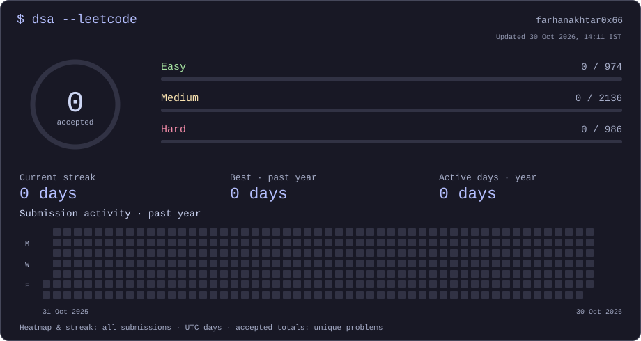

# DSA in C++

My C++20 data structures and algorithms practice, organized by topic. First uploads are planned for the week of **26 October 2026**. This repository starts empty; only solutions I upload will appear below.

[LeetCode · farhanakhtar0x66](https://leetcode.com/u/farhanakhtar0x66/) · [GitHub profile](https://github.com/farhanakhtar0x66)

<picture>
  <source media="(max-width: 600px)" srcset="assets/leetcode-mobile.svg" />
  
</picture>

The activity card reflects the public LeetCode account. The index below counts C++ files in this repository, so the two totals may differ.

## Solution index

<!-- solution-index:start -->
**0 solution files** uploaded to this repository.

No solutions uploaded yet. The folders and templates are ready for the first upload.
<!-- solution-index:end -->

## Add a solution

1. Copy [the C++ starter](templates/solution.cpp) into the relevant folder under `solutions/`, using a descriptive filename such as the problem slug. The starter is not a solved problem and is excluded from the index.
2. Fill in the comment header with the problem, source URL, difficulty, approach, time complexity, and extra space. The metadata is optional: the index uses the filename when a problem title is missing.
3. Include the headers and any node or helper types required to compile the file on its own. A standalone `main` or a judge-style `class Solution` both work. Add local assertions or test cases for correctness; CI checks syntax only.
4. Optionally copy [the notes template](templates/notes.md) beside the solution to record the reasoning and edge cases.
5. Run the checks below, commit, and push. The README index is refreshed automatically after a successful push to `main`.

```sh
python3 scripts/update_index.py
python3 scripts/update_index.py --check
python3 -m unittest discover -s tests -v
g++ -std=c++20 -Wall -Wextra -pedantic -fsyntax-only templates/solution.cpp
```

For an uploaded solution, run the same compiler command against its path. To run a standalone program, compile without `-fsyntax-only`, choose an output file under `build/`, and execute it with your test inputs.

## Topics

`arrays` · `strings` · `searching` · `sorting` · `recursion` · `linked-lists` · `stacks-queues` · `trees` · `graphs` · `dynamic-programming` · `greedy` · `heaps` · `hashing` · `bit-manipulation` · `math`

Create a more specific subfolder when it helps. The index includes nested `.cpp` files and ignores templates and notes. It counts uploaded solution files, not unique solved problems or accepted submissions.

## Automation

The solutions workflow runs Python tests and a C++20 syntax check for every solution on pull requests and pushes to `main`. On a successful `main` push, a separate job updates only the marked index and commits a changed README as `github-actions[bot]`. Pull requests receive no write token. The updater never force-pushes.

If branch protection or repository settings block bot commits, regenerate the index locally and include `README.md` in your commit. A concurrent push may also require a rerun. Syntax checks do not execute solutions or prove their correctness.


## How the activity card works

The card reads public data from [my LeetCode account](https://leetcode.com/u/farhanakhtar0x66/).
Accepted totals count unique accepted problems. The calendar and streak count
**all submission days**, including attempts, using LeetCode's UTC day buckets.
A current streak remains active if the last submission was today or yesterday;
a gap of a full day resets it. Best run and active days refer to the visible
past-year window. These numbers are separate from files uploaded here.

The repository-owned workflow refreshes the snapshot at **07:47 and 19:47 IST**
(02:17 and 14:17 UTC), plus manual runs. GitHub schedules can be delayed, and
GitHub may pause schedules after prolonged repository inactivity. The card
shows its snapshot time. Network or account errors fail the refresh without
publishing invented zeros; the last successful committed snapshot remains.
The profile can embed these SVGs directly from this repository.

To refresh locally, using Python 3.9+:

```sh
python3 scripts/leetcode_card.py --fetch
python3 scripts/leetcode_card.py --check
```

Without `--fetch`, generation is offline and uses `data/leetcode.json`.
No passwords, LeetCode session cookies, external card service, or custom secrets
are needed. GitHub Actions commits only generated data and assets with its
repository token. The card is static and has a separate mobile layout.
